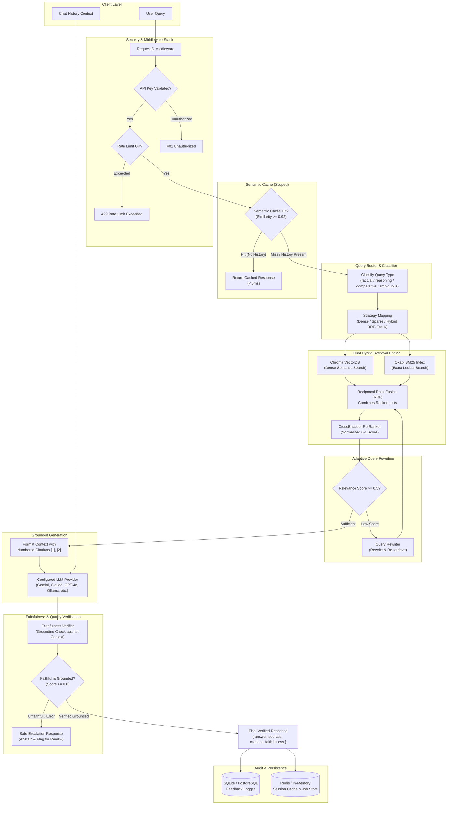

# RAG MONSTER

### Modular Orchestrated Neural Semantic Text Embedding & Retrieval

A **production-grade, self-adapting RAG system** with multi-provider LLM support, smart query routing, semantic caching, hallucination detection, and an adaptive strategy engine — all with zero friction for local development.

---

## What's New

| Feature                      | Description                                                                                                                                             |
| ---------------------------- | ------------------------------------------------------------------------------------------------------------------------------------------------------- |
| **BM25 + Dense RRF**         | Hybrid retrieval combining BM25 lexical search and dense vector search via Reciprocal Rank Fusion (RRF)                                                 |
| **Normalized Re-ranking**    | CrossEncoder scores normalized to 0–1 probability and attached to `doc.metadata['relevance_score']`                                                     |
| **Faithfulness Enforcement** | Unverified or hallucinated responses are automatically intercepted and replaced with safe escalation responses                                          |
| **Scoped Semantic Cache**    | Cache entries isolated by user/session/ACL scope and index version; invalidated on index changes using non-blocking Redis SCAN                          |
| **Deterministic Chunk IDs**  | Content-hashed chunk IDs ensure idempotent upserts in Chroma without duplicate chunks on re-index                                                       |
| **Expanded Ingestion**       | Full support for `.docx`, `.html`, and directory crawling with SSRF protection and path allowlisting                                                    |
| **300k+ LoC Code Chunker**   | AST- and syntax-aware logical chunking for large codebases (classes, methods, functions) at >185,000 LoC/sec                                            |
| **Hardened Security**        | API key mandatory on non-localhost bindings, constant-time `hmac.compare_digest`, protected `/metrics`, restricted CORS, and trusted proxy verification |
| **Durable Job Store**        | Asynchronous indexing job status and rate limiting persisted in Redis with in-memory fallback                                                           |
| **Automated Eval Benchmark** | Comprehensive evaluation harness over a 7-document enterprise corpus reporting recall, MRR, citation accuracy, and abstention                           |

---

## Architecture



---

## Supported LLM Providers

RAG_MONSTER detects the provider automatically from the model string:

### Cloud API

| Provider          | Example Model String                                          | Env Var              |
| ----------------- | ------------------------------------------------------------- | -------------------- |
| **OpenAI**        | `openai:gpt-4o`, `gpt-4o-mini`                                | `OPENAI_API_KEY`     |
| **Anthropic**     | `anthropic:claude-3-5-sonnet-20241022`                        | `ANTHROPIC_API_KEY`  |
| **Google Gemini** | `gemini:gemini-2.5-flash`                                     | `GEMINI_API_KEY`     |
| **Groq**          | `groq:llama-3.3-70b-versatile`                                | `GROQ_API_KEY`       |
| **DeepSeek**      | `deepseek:deepseek-chat`                                      | `DEEPSEEK_API_KEY`   |
| **Mistral AI**    | `mistral:mistral-large-latest`                                | `MISTRAL_API_KEY`    |
| **OpenRouter**    | `openrouter:anthropic/claude-3.5-sonnet`                      | `OPENROUTER_API_KEY` |
| **Together AI**   | `together:meta-llama/Llama-3.3-70B-Instruct-Turbo`            | `TOGETHER_API_KEY`   |
| **Fireworks AI**  | `fireworks:accounts/fireworks/models/llama-v3p3-70b-instruct` | `FIREWORKS_API_KEY`  |

### Local / Self-Hosted

| Mode                 | Example Model String                  | Notes                          |
| -------------------- | ------------------------------------- | ------------------------------ |
| **Ollama**           | `ollama:llama3`, `llama3:latest`      | Default; set `OLLAMA_BASE_URL` |
| **llama.cpp server** | `llamacpp:local-model`                | Set `LLAMACPP_HOST`            |
| **vLLM / LMStudio**  | `openai_compat:my-model`              | Set `OPENAI_BASE_URL`          |
| **HF Weights dir**   | `/path/to/model` or `./models/llama3` | Auto-detects `config.json`     |
| **GGUF file**        | `weights:./models/model.gguf`         | Requires `llama-cpp-python`    |

---

## Installation

### Option A: Local (Python venv)

```bash
# 1. Clone & setup
git clone <repo-url> && cd RAG_MONSTER
python3 -m venv venv && source venv/bin/activate
pip install -r requirements.txt

# 2. Optional: local weights support
pip install torch transformers accelerate   # HuggingFace safetensors
pip install llama-cpp-python               # GGUF files

# 3. Optional: Prometheus metrics
pip install prometheus-fastapi-instrumentator

# 4. Configure
cp .env.example .env   # then edit .env

# 5. Start Ollama (if using local models/embeddings)
ollama pull nomic-embed-text
ollama pull llama3

# 6. Run
python app.py
```

### Option B: Docker Compose (recommended for production)

```bash
cp .env.example .env   # edit as needed
docker compose up -d
```

This starts:

- **RAG_MONSTER API** → `http://localhost:8000`
- **Chroma server** → `http://localhost:8001`
- **Redis** → `localhost:6379`
- Swagger UI → `http://localhost:8000/docs`

Add Prometheus monitoring:

```bash
docker compose --profile monitoring up -d
```

---

## Configuration Reference

All settings are via environment variables (`.env` file or shell export).

### Core

| Variable               | Default                    | Description                                         |
| ---------------------- | -------------------------- | --------------------------------------------------- |
| `LLM_MODEL`            | `llama3:latest`            | Default model — any supported provider:model string |
| `CHROMA_PATH`          | `./chroma_db`              | Local Chroma persistence directory                  |
| `EMBEDDING_MODEL_NAME` | `nomic-embed-text`         | Embedding model                                     |
| `CHUNKING_STRATEGY`    | `recursive`                | `recursive` or `semantic`                           |
| `REDIS_URL`            | `redis://localhost:6379/0` | Redis URL (in-memory fallback if unreachable)       |

### Generation Quality

| Variable          | Default | Description                                        |
| ----------------- | ------- | -------------------------------------------------- |
| `LLM_TEMPERATURE` | `0.0`   | Temperature for LLM generation (0 = deterministic) |
| `LLM_MAX_TOKENS`  | `2048`  | Max output tokens per response                     |
| `LLM_MAX_RETRIES` | `3`     | Retry attempts on transient LLM errors             |

### Enterprise / Security

| Variable                | Default   | Description                                                                                                     |
| ----------------------- | --------- | --------------------------------------------------------------------------------------------------------------- |
| `API_KEY`               | _(empty)_ | **If empty → auth disabled (local mode).** If set → all API requests must include `Authorization: Bearer <key>` |
| `RATE_LIMIT_PER_MINUTE` | `0`       | Per-IP rate limit. `0` = disabled                                                                               |

### Server

| Variable       | Default                       | Description                                        |
| -------------- | ----------------------------- | -------------------------------------------------- |
| `HOST`         | `0.0.0.0`                     | Server bind host                                   |
| `PORT`         | `8000`                        | Server bind port                                   |
| `DATABASE_URL` | `sqlite:///./rag_feedback.db` | Feedback log DB (SQLite default, Postgres in prod) |

### Local Inference

| Variable          | Default                  | Description                     |
| ----------------- | ------------------------ | ------------------------------- |
| `OLLAMA_BASE_URL` | `http://localhost:11434` | Ollama server URL               |
| `LLAMACPP_HOST`   | `http://localhost:8080`  | llama.cpp server URL            |
| `WEIGHTS_DEVICE`  | `auto`                   | `auto`, `mps`, `cuda`, or `cpu` |

### API Keys

`OPENAI_API_KEY`, `ANTHROPIC_API_KEY`, `GEMINI_API_KEY`, `GROQ_API_KEY`, `DEEPSEEK_API_KEY`, `MISTRAL_API_KEY`, `OPENROUTER_API_KEY`, `TOGETHER_API_KEY`, `FIREWORKS_API_KEY`

---

## API Reference

Swagger UI: **`http://localhost:8000/docs`**
All endpoints are also available under `/v1/` prefix for versioned clients.

### Ops & Health

| Method | Endpoint                | Description                                                       |
| ------ | ----------------------- | ----------------------------------------------------------------- |
| `GET`  | `/health`               | Liveness probe — always returns `{"status": "ok"}`                |
| `GET`  | `/ready`                | Readiness probe — checks Chroma + Redis connectivity              |
| `GET`  | `/metrics`              | Prometheus metrics (requires `prometheus-fastapi-instrumentator`) |
| `GET`  | `/semantic-cache/stats` | Cache hit rate and size                                           |
| `GET`  | `/providers`            | All LLM providers + configuration status                          |

### Ingestion

| Method | Endpoint               | Body                          | Description                                                  |
| ------ | ---------------------- | ----------------------------- | ------------------------------------------------------------ |
| `POST` | `/index`               | `{"source": "path/or/url"}`   | Index a document synchronously                               |
| `POST` | `/index/codebase`      | `{"source": "/path/to/repo"}` | Ingest entire codebase with AST logical chunking             |
| `POST` | `/index/async`         | `{"source": "path/or/url"}`   | Index in background, returns `{"job_id": "..."}` immediately |
| `GET`  | `/index/jobs/{job_id}` | —                             | Check async indexing job status                              |

### Query

| Method | Endpoint        | Body                                                                | Description           |
| ------ | --------------- | ------------------------------------------------------------------- | --------------------- |
| `POST` | `/query`        | `{"session_id": "s1", "question": "...", "model": "openai:gpt-4o"}` | Full RAG query        |
| `POST` | `/query/stream` | same                                                                | Stream answer via SSE |

**Query response includes:**

```json
{
  "answer": "...",
  "sources": ["doc1.pdf", "doc2.md"],
  "query_type": "factual",
  "strategy": "dense",
  "faithfulness": {
    "score": 0.94,
    "faithful": true,
    "hallucinated_claims": []
  },
  "was_rewritten": false,
  "rewritten_query": null,
  "latency_ms": 820.4,
  "cache_hit": false,
  "log_id": 42
}
```

### Adaptation & Feedback

| Method | Endpoint    | Body                            | Description                                     |
| ------ | ----------- | ------------------------------- | ----------------------------------------------- |
| `POST` | `/feedback` | `{"log_id": 42, "feedback": 1}` | Rate an answer (1=good, 0=bad)                  |
| `POST` | `/adapt`    | —                               | Recalibrate routing strategy from feedback logs |

### Session & Admin

| Method   | Endpoint                | Description                      |
| -------- | ----------------------- | -------------------------------- |
| `DELETE` | `/history/{session_id}` | Clear chat history for a session |
| `DELETE` | `/db`                   | Clear the entire vector database |

---

## CLI Usage

```bash
# List providers
python cli.py providers

# Index a document
python cli.py index "data/report.pdf"

# Query (default model)
python cli.py query "Summarize the report" --show-context

# Query with specific model
python cli.py query "What changed in Q3?" --model "gemini:gemini-2.5-flash"

# Streaming
python cli.py query "Draft an executive summary" --model "openai:gpt-4o" --stream

# Session management
python cli.py clear-history "my_session"
python cli.py clear-db
python cli.py deep-reset
```

---

## Semantic Visualizer

Explore stored embeddings in an interactive 2D/3D semantic map:

```bash
streamlit run viz.py
```

---

## Running the Eval Harness

```bash
python eval/run_eval.py --model "gemini:gemini-2.5-flash"
```

Reports: `recall@5`, `MRR`, `answer_correctness`, `citation_accuracy`, `abstention_rate`, `latency_avg_s`, `latency_p95_s`.

---

## Local Development (Zero Enterprise Friction)

For local use, leave `API_KEY` and `RATE_LIMIT_PER_MINUTE` unset in your `.env` — auth and rate limiting are **completely disabled**. All enterprise features are opt-in via env vars:

```env
# .env — minimal local config
LLM_MODEL=ollama:llama3
CHROMA_PATH=./chroma_db
# Optionally set a cloud key to use API models:
# GEMINI_API_KEY=your-key-here
```

---

## Project Structure

```
RAG_MONSTER/
├── app.py                       # FastAPI server (v2.0)
├── main_rag.py                  # RAGPipeline orchestrator
├── config.py                    # All configuration via env vars
├── cli.py                       # Typer CLI
├── viz.py                       # Streamlit embedding visualizer
├── requirements.txt
├── Dockerfile
├── docker-compose.yml
├── prometheus.yml
│
├── core/
│   ├── middleware.py            # RequestID, APIKey, RateLimit middleware
│   ├── semantic_cache.py        # Cosine-similarity query cache
│   ├── query_router.py          # Query classification + strategy routing
│   ├── query_rewriter.py        # Low-quality retrieval → query rewrite + retry
│   ├── faithfulness_verifier.py # Post-generation hallucination guard
│   ├── feedback_logger.py       # SQLite audit log
│   ├── adaptation_engine.py     # Self-adapting strategy recalibration
│   ├── retriever.py             # Vector retrieval + CrossEncoder reranker
│   ├── reranker.py              # CrossEncoder (thread-pool offloaded)
│   ├── vdb.py                   # Chroma vector store interface
│   ├── embedder.py              # Pluggable embedding models
│   ├── chunker.py               # Recursive + semantic chunking
│   ├── document_loader.py       # PDF, TXT, MD, URL loader
│   ├── cache.py                 # Redis + in-memory session cache
│   └── llm/                     # 13-provider LLM registry
│       ├── registry.py
│       ├── base.py
│       ├── gemini_provider.py
│       └── ...
│
└── eval/
    ├── run_eval.py              # Evaluation harness
    └── data/                    # Sample evaluation documents
```
